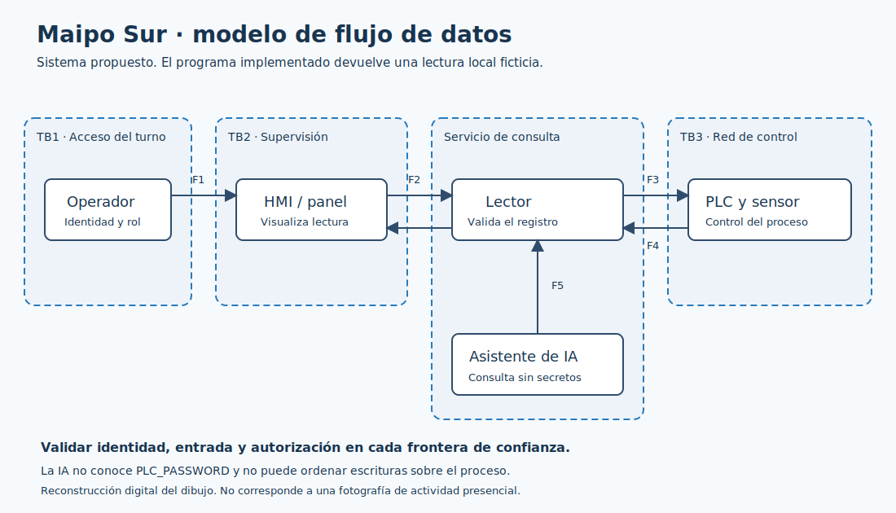

# Sistema, componentes y fronteras

Elegimos el caso base de agua potable porque el taller entrega la dosificación de cloro como escenario común. La planta ficticia Maipo Sur abastece a 80.000 personas según el material de la actividad. La asignación de sector a este grupo no venía indicada.

## Sistema representado y sistema implementado

El modelo representa sensores y PLC en control básico, HMI en supervisión y un servicio lector detrás de una frontera de red. La red corporativa no debe alcanzar directamente el PLC. Un asistente puede consultar información de lectura, pero no recibir credenciales ni ordenar cambios.

La implementación es más acotada: un programa local valida configuración y variable de entorno, y devuelve un dato preparado. No existen un PLC, HMI, servicio HTTPS o asistente desplegados. Las defensas de red y autorización del modelo requieren implementación y pruebas adicionales antes de una operación real.

| Flujo | Datos | Frontera y validación prevista |
|---|---|---|
| F1 Operador → HMI | Consulta de lectura | TB1: autenticar operador y limitar su rol |
| F2 HMI → lector | Solicitud de registro | TB2: validar registro, origen y autorización |
| F3 lector → PLC | Consulta de solo lectura | TB3: credencial custodiada, protocolo aprobado y red segmentada |
| F4 PLC → lector → HMI | Concentración simulada | Validar tipo, rango y antigüedad; registrar errores |
| F5 asistente → lector | Consulta limitada | Identidad independiente, sin acceso al secreto ni escritura |

El lector del laboratorio no transmite F1-F5 por una red. El diagrama muestra dónde deben ubicarse los controles en la arquitectura propuesta. El archivo Terraform representa la restricción del panel, no configura redes industriales reales.

Archivo editable: [dfd.drawio](dfd.drawio). El PNG conserva flechas y fronteras de confianza. Se entrega un dibujo digital porque no existe una foto del ejercicio presencial proporcionada por el grupo.

`infra/panel.yaml` expresa la política operacional equivalente al modelo Terraform. Trivy usa la regla local `LAB-ICS-001` para impedir origen global, además de sus checks generales. No se crean recursos cloud.
